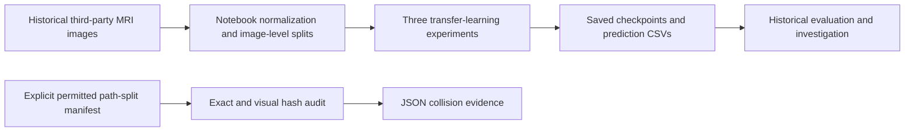

# Alzheimer's MRI: an experiment I could not trust

I compared three MRI image-classification models and withdrew their generalization claims after investigating contamination between evaluation splits.

## The problem

The experiment classified images into four dementia-related categories. Unusually high accuracy prompted a second question: were related images shared across training and test splits, making evaluation unreliable?

## What I built

Notebook experiments for image normalization, pretrained-model fine-tuning, model selection and saved predictions. The later portfolio cleanup added a manifest-driven duplicate audit with synthetic tests and explicit provenance limits. This is a data-integrity case study, not a diagnostic tool.

## Architecture



## How it works

Historical notebooks normalize image intensity, vary which pretrained layers are retrained, select configurations and evaluate reloaded checkpoints. The new audit separately reads a CSV with `path,split`, fingerprints exact bytes with SHA256 and flags visual similarities with an average hash. A visual match requires investigation; it does not identify a patient.

## ML / AI methodology

The target has four classes. Historical transfer-learning experiments compare DenseNet121, ResNet50 and EfficientNetB0, including an earlier ResNet50 baseline and different fine-tuning choices. Evaluation uses accuracy and per-class precision, recall and F1 (a combined precision/recall score).

The split is image-level, not patient-level. Related and pre-augmented images may cross splits. There is no clean patient-level baseline or external evaluation establishing generalization. EfficientNet's final reloaded checkpoint predicted one class; its cause remains unresolved.

## Engineering

Notebook configuration, checkpoint callbacks and CSV/JSON/PNG experiment artifacts exist. The lightweight audit adds manifest validation, file hashes and two synthetic tests. It does not reproduce the original training environment or the original consumed image split.

## Results

| Model | Historical test accuracy | Meaning |
|---|---:|---|
| DenseNet121 | 99.83% | Withdrawn as evidence of generalization |
| ResNet50 | 99.71% | Same contaminated evaluation |
| EfficientNetB0 | 25.45% | Final reloaded checkpoint only; cause unresolved |

Each saved test CSV contains **6,600 rows**. Recalculation confirmed these values, without validating the split. **Two synthetic audit tests passed** on 13 October 2026, checking exact cross-split duplicates, a visual false match and invalid manifests. No medical images were required or reprocessed in that check.

## Demo


This image is historical rejected-evaluation evidence, not diagnostic performance. The [original report](notebooks/Alzheimer%27s_Disease_Final_Project_Report.ipynb) preserves the investigation and hypotheses. There is no live deployment.

## Run locally

The verified path is the small audit and synthetic tests, not model retraining:

```powershell
python -m venv .venv
.\.venv\Scripts\python.exe -m pip install -r requirements-audit.txt
.\.venv\Scripts\python.exe -m pytest tests -q
```

For images you have permission to process, create a CSV with `path,split`; paths are relative to the CSV and labels are `train`, `validation` or `test`. Then use:

```powershell
.\.venv\Scripts\python.exe audit_duplicates.py permitted_split.csv --output audit_result.json
```

This invocation is conditional on your own permitted manifest; it was not run on the original medical dataset. Read [data provenance and audit limits](DATA_PROVENANCE.md) first.

## Repository structure

- `notebooks/`: historical experiments and final report.
- `results_and_visuals/`: saved prediction CSVs, configuration and figures.
- `audit_duplicates.py`, `tests/`, `requirements-audit.txt`: lightweight audit and synthetic checks.
- `DATA_PROVENANCE.md`: unresolved source and evaluation boundaries.

## Limitations

Image source, redistribution licence, patient identities and the exact consumed split remain unresolved. Weights and a pinned training environment are absent; private notebook paths prevent a verified training rerun. The synthetic tests validate audit mechanics, not an original leakage percentage. There is no clinical validation, deployment or demonstrated patient benefit. No controlled experiment proves that normalization or batch normalization caused EfficientNet's failure.

## What I would improve next

1. Resolve permitted image provenance and preserve the exact split manifest.
2. Build a clean patient-level evaluation before making predictive claims.
3. Investigate checkpoint reload behaviour with controlled tests.

## My contribution

The experiments and report are recorded under my sole author identity. The original repository arrived in one bulk commit, so incremental contribution history is unavailable. Third parties supplied images and pretrained architectures; I did not collect or clinically label the scans. The portfolio audit additions are a later AI-assisted cleanup, not a retraining claim.
