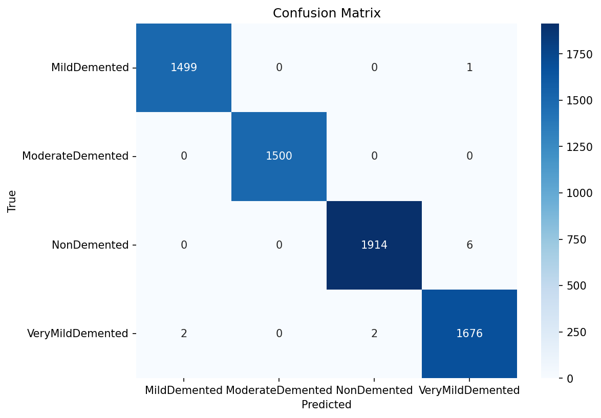

# Alzheimer's MRI: Transfer Learning and Data Integrity Investigation

A four-class MRI transfer-learning experiment whose apparent high accuracy was rejected after an investigation found duplicate contamination and an invalid evaluation design.

## Problem

Compare ResNet50, DenseNet121 and EfficientNetB0 on MRI slices, then investigate whether the reported results measured generalization to unseen patients.

## What I did

I implemented the notebook experiments, per-image median/IQR normalization, freeze-depth comparisons, model-selection logic and saved prediction/metric artifacts. I documented a post-training duplicate investigation and withdrew the high-accuracy result as evidence of predictive performance. This is my experimental work on third-party images; I did not collect or clinically label the dataset. The repository was uploaded in one commit, so it does not preserve an incremental development trail.

## Method

The V2 notebooks compare three ImageNet backbones with a common classification head and different freezing depths. They consume an image-level stratified split, not a patient-grouped split. Pre-augmented and near-duplicate images undermine split independence. Minimizing the training/validation gap cannot correct contaminated validation data.

## Evaluation / Results

**These are historical outputs from an invalid evaluation, not estimates of clinical or unseen-patient performance.**

| Architecture | Recorded final test accuracy | Interpretation |
|---|---:|---|
| DenseNet121, first 140 layers frozen | 99.83% | Withdrawn as a generalization claim because of contamination |
| ResNet50, all layers unfrozen | 99.71% | Same invalid evaluation setting |
| EfficientNetB0, selected final checkpoint | 25.45% | Collapsed to one class after reload; cause not established |

Each recorded test prediction file contains 6,600 rows. EfficientNet's 25.45% is its final reloaded-checkpoint result, not the result of every experiment: its sweep includes much higher validation scores. No controlled experiment establishes batch normalization or custom normalization as the cause of the collapse.

## Key finding

The project supports a data-integrity case study: apparently excellent image-level metrics can be invalid when related images cross splits. It does not establish a usable Alzheimer's classifier or a superior clinical architecture.

## Evidence and limitations

- [Final investigation report](notebooks/Alzheimer%27s_Disease_Final_Project_Report.ipynb): historical narrative and embedded duplicate-audit screenshot. Some historical explanatory claims are hypotheses; the qualifications in this README govern the application snapshot.
- [DenseNet experiments](notebooks/Alzheimer%27s_densenet-experiments-and-final-training.ipynb), [ResNet experiments](notebooks/Alzheimer%27s_resnet-experiments-and-final-training.ipynb), [EfficientNet experiments](notebooks/Alzheimer%27s_efficientnet-experiments-and-final-training.ipynb).
- [Saved results](results_and_visuals/): prediction CSVs, per-class metrics, configurations and figures. The figure below is a record of the rejected evaluation, not a clinical result.

Dataset provenance, redistribution licence and patient identities are not established in the repository. Do not infer permission to reuse its images or a verified number of source scans. The split notebook has no saved execution outputs; the exact consumed Kaggle split and trained weights are not included. The original duplicate audit is preserved as a screenshot, not an executable audit script. There is no patient-level/external validation, clinical deployment, API or demonstrated clinical benefit.

## Reproducibility

The committed CSVs and notebook outputs can be inspected without retraining. Full training reproduction is not established: notebooks reference external/private Kaggle inputs and Colab paths, and there is no pinned environment. No new training or corrected clean-data evaluation is claimed.

## Contact

[Theresia Saumu on LinkedIn](https://www.linkedin.com/in/theresia-saumu/) · [Email](mailto:theresia.saumu@gmail.com)
