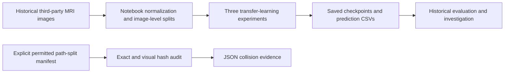

# Alzheimer's MRI: Comparative Classification Experiments

I built a comparative MRI classification workflow across DenseNet121, ResNet50 and EfficientNetB0, including normalization, block-wise fine-tuning, checkpoint evaluation and saved predictions. The investigation led to a recommendation to restart with raw, non-augmented data such as ADNI or OASIS and patient-level evaluation before deployment.

## The problem

The experiment classified images into four dementia-related categories. Unusually high accuracy prompted a second question: were related images shared across training and test splits, making evaluation unreliable?

## What I built

I implemented three transfer-learning experiment pipelines for four-class MRI image classification: intensity normalization, configurable fine-tuning, model selection from training/validation behavior, checkpoint reload evaluation and saved prediction artifacts. The framework made it possible to compare architectures and investigate whether apparently strong results were trustworthy.

The experiment and written recommendation are the main outputs. A later manifest-driven duplicate-audit utility adds reproducible synthetic checks and explicit provenance limits. This research workflow is not a clinically validated diagnostic tool.

## Architecture



## How it works

Historical notebooks normalize image intensity, vary which pretrained layers are retrained, select configurations and evaluate reloaded checkpoints. The new audit separately reads a CSV with `path,split`, fingerprints exact bytes with SHA256 and flags visual similarities with an average hash. A visual match requires investigation; it does not identify a patient.

## ML / AI methodology

The target has four classes. Historical transfer-learning experiments compare DenseNet121, ResNet50 and EfficientNetB0, including an earlier ResNet50 baseline and different fine-tuning choices. Evaluation uses accuracy and per-class precision, recall and F1 (a combined precision/recall score).

The split is image-level, not patient-level. Related and pre-augmented images may cross splits. There is no clean patient-level baseline or external evaluation establishing generalization. EfficientNet's final reloaded checkpoint predicted one class; its cause remains unresolved.

## Engineering

Notebook configuration, checkpoint callbacks and CSV/JSON/PNG experiment artifacts exist. The lightweight audit adds manifest validation, file hashes and two synthetic tests. It does not reproduce the original training environment or the original consumed image split.

## Results

The work produced **three architecture experiment pipelines**, saved predictions and a written recommendation to rebuild on suitable raw data before further performance claims. Each saved test-prediction CSV contains 6,600 rows.

The investigation identified an evaluation-integrity problem that changing architectures alone could not resolve. Related and pre-augmented images may cross the image-level splits; the exact consumed split cannot be reconstructed. The reported scores therefore do not establish unseen-patient performance.

The [original final report](notebooks/Alzheimer%27s_Disease_Final_Project_Report.ipynb) recommends raw, non-augmented ADNI or OASIS data and no deployment on the present evidence. Patient-level evaluation is a next step, not completed work. EfficientNet's reloaded checkpoint predicted one class; its cause remains unresolved.

The [historical evaluation record](EVALUATION_RECORD.md) preserves the rejected scores, saved-artifact checks and later synthetic audit results. [Data provenance](DATA_PROVENANCE.md) explains the reconstruction limits.

## Demo

[Explore the experiment notebooks and recommendation](notebooks/Alzheimer%27s_Disease_Final_Project_Report.ipynb).

The saved [historical confusion matrix](results_and_visuals/densenet/confusion_matrix.png) is rejected-evaluation evidence, not diagnostic performance. There is no live deployment.

## Run locally

The verified path is the small audit and synthetic tests, not model retraining:

```powershell
python -m venv .venv
.\.venv\Scripts\python.exe -m pip install -r requirements-audit.txt
.\.venv\Scripts\python.exe -m pytest tests -q
```

For images you have permission to process, create a CSV with `path,split`; paths are relative to the CSV and labels are `train`, `validation` or `test`. Then use:

```powershell
.\.venv\Scripts\python.exe audit_duplicates.py permitted_split.csv --output audit_result.json
```

This invocation is conditional on your own permitted manifest; it was not run on the original medical dataset. Read [data provenance and audit limits](DATA_PROVENANCE.md) first.

## Repository structure

- `notebooks/`: historical experiments and final report.
- `results_and_visuals/`: saved prediction CSVs, configuration and figures.
- `audit_duplicates.py`, `tests/`, `requirements-audit.txt`: lightweight audit and synthetic checks.
- `DATA_PROVENANCE.md`: unresolved source and evaluation boundaries.

## Limitations

Image source, redistribution licence, patient identities and the exact consumed split remain unresolved. Weights and a pinned training environment are absent; private notebook paths prevent a verified training rerun. The synthetic tests validate audit mechanics, not an original leakage percentage. There is no clinical validation, deployment or demonstrated patient benefit. No controlled experiment proves that normalization or batch normalization caused EfficientNet's failure.

## What I would improve next

1. Obtain permitted raw, non-augmented data such as ADNI or OASIS and preserve its provenance.
2. Build a clean patient-level split and evaluation before making predictive claims.
3. Investigate checkpoint reload behaviour with controlled tests.

## My contribution

The experiments and report are recorded under my sole author identity. The original repository arrived in one bulk commit, so incremental contribution history is unavailable. Third parties supplied images and pretrained architectures; I did not collect or clinically label the scans. The portfolio audit additions are a later AI-assisted cleanup, not a retraining claim.
